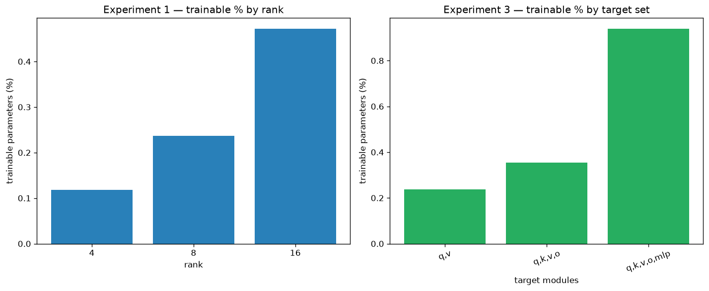
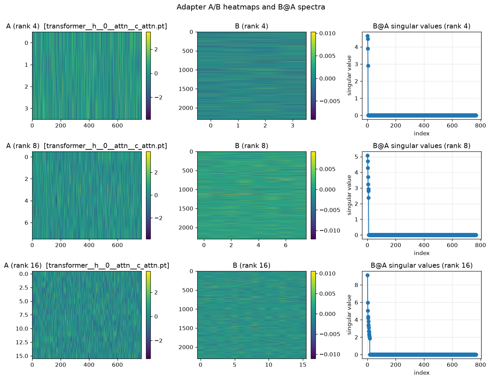
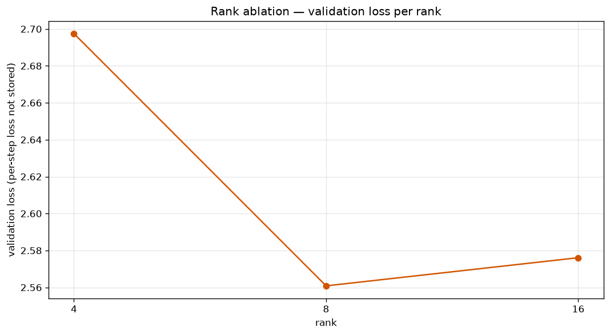
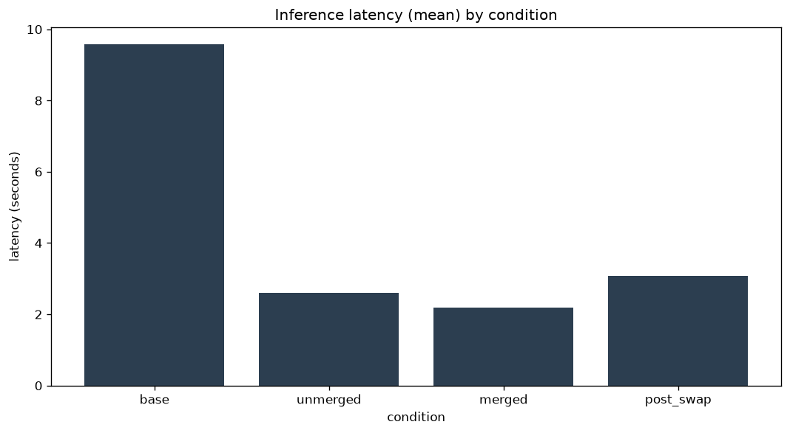
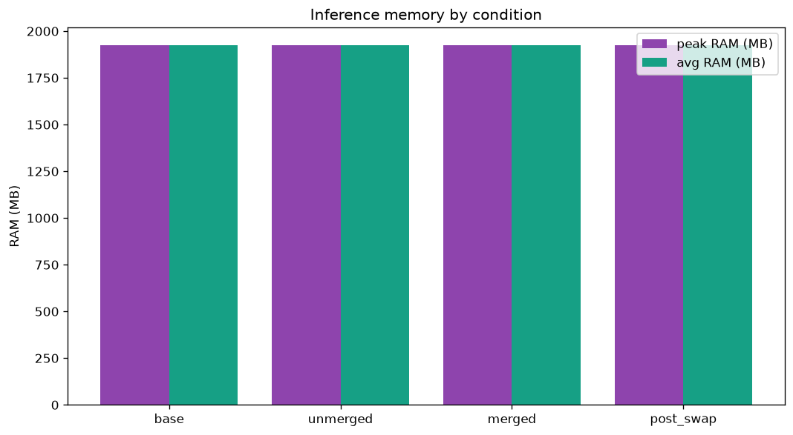
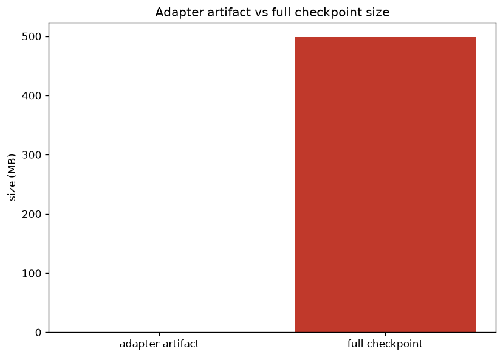
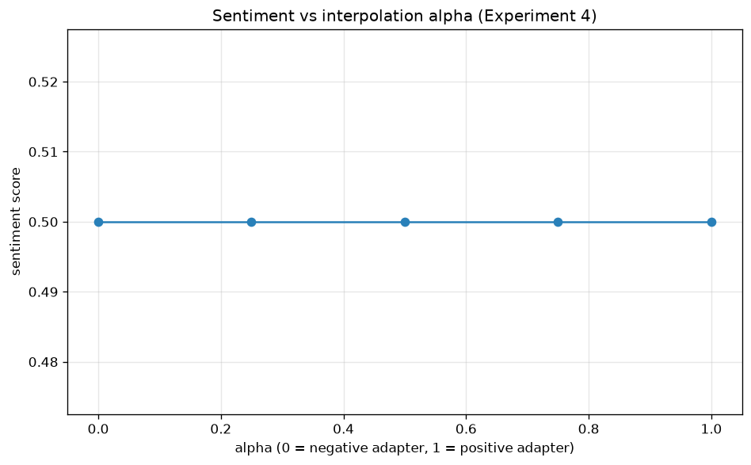
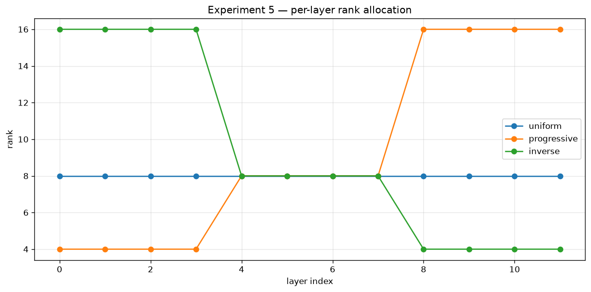
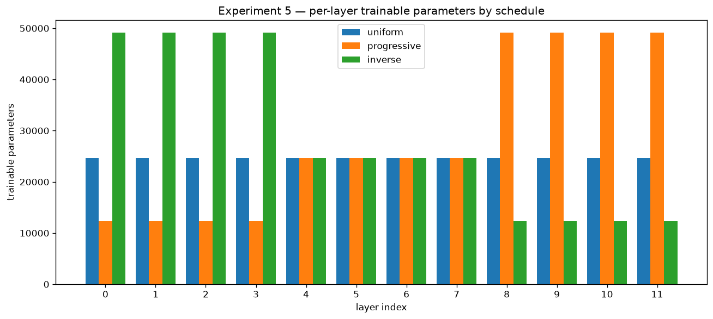
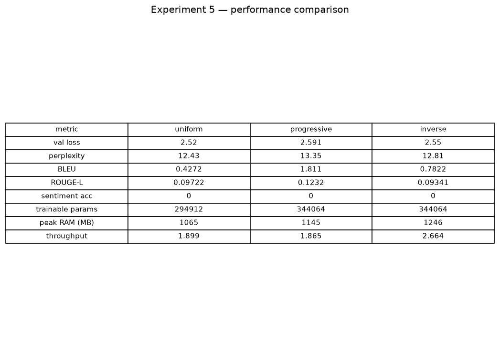

# catalyst

a from-scratch implementation of lora (low-rank adaptation) for fine-tuning gpt-2, written without the peft library so every step is visible. the point was partly to learn how lora actually works under the hood, and partly to poke at one question: if you only get to train a tiny slice of the model, does it matter *how* you spread that slice across the layers?

## why

fine-tuning every weight of a language model is expensive and usually overkill. lora freezes the pretrained weights and only learns a small low-rank update per layer, `dW = (alpha/r) * B @ A`, so you end up training a fraction of a percent of the parameters. catalyst builds that mechanism by hand and then uses it to run a few small experiments, the last of which compares uneven per-layer rank schedules at the same parameter budget.

## what's in here

it's a layered pipeline, each piece only depends on the ones below it:

- `lora.py` — the core. builds A (gaussian) and B (zeros), freezes the base weight, does the forward pass, and handles merge/unmerge, save/load, swap and interpolation. also deals with gpt-2 storing its weights transposed in `Conv1D` and fusing q/k/v into one `c_attn`.
- `model.py` / `data.py` — injecting lora into the model by inspecting its architecture (not hardcoded names), plus loading sst-2 and prepending `[POSITIVE]`/`[NEGATIVE]` tags.
- `train.py` / `evaluate.py` — a small training loop with a runtime estimate, and an evaluator that computes the quantitative metrics plus an optional gemini judge (clearly marked as supplementary).
- `experiments.py` — runs the five experiments in order, writes real numbers to json before moving on, and records reproducibility metadata + a manifest.
- `visualize.py` / `compare.py` — plots from the json files, and a terminal cli to compare model variants side by side. no web server, no dashboard.

## how this run was done

all the numbers below come straight from the json files in `results/`. they were produced by one ordered run on a laptop cpu with a deliberately small budget, so they're meant to be reproducible and easy to sanity-check, not state of the art.

the settings for this run:

- model: gpt-2 124m (the default)
- max_steps: 30, batch_size: 8
- eval examples: 16, latency warmup/timed: 2/5, memory samples: 2
- decoding: greedy (temperature 0, top-k off, top-p 1)
- alpha: 16, seed: 42 (torch/numpy/random)
- python 3.14.2, torch 2.10.0+cpu, git commit: unavailable

the shipped config (`configs/default.yaml`) keeps the fuller methodology (max_steps 200, latency 5/50); the reduced values above are what each `*_metadata.json` actually recorded.

## plots

rendered from the json by `visualize.visualize_all`:

## results

### experiment 1 — how few parameters

trainable params at ranks 4/8/16 with `[q, v]` targets, against gpt-2's ~124.6m total:

- rank 4: 147,456 params (0.118%)
- rank 8: 294,912 params (0.236%)
- rank 16: 589,824 params (0.472%)

even at rank 16 it's under half a percent of the model.

### experiment 2 — does rank matter

three adapters at ranks 4/8/16, on the 16-example validation slice. validation loss / perplexity: rank 4 = 2.697 / 14.84, rank 8 = 2.561 / 12.95, rank 16 = 2.576 / 13.15. so it improves from 4 to 8 and then flattens. sentiment accuracy and gemini scores come out as 0 here — with 30 steps and 16 examples those signals just aren't meaningful yet, which is expected.

### experiment 3 — which modules

same rank 8, varying which projections get adapters. validation loss drops as you adapt more: `q,v` = 2.648, `q,k,v,o` = 2.497, `q,k,v,o,mlp` = 2.451 (at 0.236% / 0.354% / 0.939% trainable). adding the mlp helps the loss but costs the most parameters.

### experiment 4 — merge, swap, blend

trains a positive and a negative adapter and exercises the whole lifecycle:

- merge equivalence: max absolute difference between the unmerged and merged forward pass is 6.1e-05, so folding the update into the base weight basically doesn't change anything (which is the point).
- swap: switching the active adapter from positive to negative works and the outputs visibly differ.
- save/load/list round trip: works.
- interpolation: blending from positive to negative does drift the generated text from upbeat toward negative phrasing, but the recorded numeric sentiment score sits flat at 0.5 for every alpha. so on the actual scores this run can't say whether the transition is smooth or jumpy — the scorer is too coarse at this budget. honest answer: too small a run to tell, though the raw text suggests it's gradual.

### experiment 5 — where to put the rank

three schedules over gpt-2's 12 layers at roughly equal budgets: uniform (8 everywhere), progressive (4 shallow → 8 → 16 deep), inverse (16 shallow → 8 → 4 deep). validation loss: uniform 2.520, inverse 2.550, progressive 2.591. on blended-text overlap metrics the order flips (progressive has the best bleu). the budgets land within the ±20% tolerance, so it's a fair comparison. but with 30 steps these gaps are well inside the noise, so this run doesn't actually show that uneven allocation helps or hurts — it mostly confirms the machinery works and sets up a bigger run.

## limitations

- cpu only, on a laptop. no gpu.
- gpt-2 124m is small, so don't read too much into transfer to bigger models.
- sst-2 is an easy task and the `[POSITIVE]`/`[NEGATIVE]` conditioning is simple.
- greedy decoding helps reproducibility but limits output variety.
- the gemini judge is supplementary and wasn't exercised in this offline run.
- the training budget here is tiny, so treat most of the metric differences as noise. it's a reproducible smoke test, not a benchmark.

## future work

- run it properly on a gpu with a real training budget to actually test the rank-allocation idea.
- adalora-style adaptive rank that learns where to spend capacity instead of fixing schedules by hand.
- composing multiple adapters, and task-arithmetic style adding/subtracting of adapters.

## references

- hu et al. (2021), lora: low-rank adaptation of large language models. arXiv:2106.09685
- radford et al. (2019), language models are unsupervised multitask learners (gpt-2).
- zhang et al. (2023), adalora: adaptive budget allocation for parameter-efficient fine-tuning. arXiv:2303.10512
- ilharco et al. (2023), editing models with task arithmetic. arXiv:2212.04089
